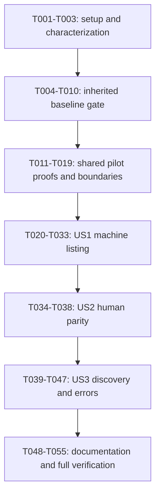

# Tasks: Order Listing For Humans And Agents

**Input**: [spec.md](spec.md), [plan.md](plan.md), [research.md](research.md),
[data-model.md](data-model.md), [CLI contract](contracts/cli.md),
[examples](contracts/examples.json), [validation guide](quickstart.md).

**Branch**: `develop` | **Generated**: 2026-10-16

**Status**: Setup T001-T003 and baseline checkpoints T004-T010 are complete;
the baseline gate is closed with recorded exceptions (Windows deferred to
T051-T052). Foundations T011-T013 are complete; T014-T055 remain pending. Checked
tasks represent only their recorded scope, not pilot runtime verification.
Earlier persistence fixes remain prior work, not new tasks to recreate.
Pre-implementation analysis completed; its A1 and U1 clarifications are applied.

**Tests**: Required by the specification and constitution. For defects, reproduce
the failing behavior before a narrow repair and immediately rerun that check.
Retain passing characterization tests without fabricating failures. New-feature
tests precede their implementation; complete each red/green increment without
leaving the worktree deliberately broken at a handoff.

## Format And Paths

Each task has a checkbox, sequential ID, optional `[P]`, story label for story
phases, exact repository-relative paths and explicit dependencies. `[P]` means
different-file work can overlap only after the listed dependencies complete.
There is no implicit authorization to spawn agents, commit or change branches.

Paths are relative to mostro-cli unless prefixed `../mcp/`. New source paths are
planned homes, not assertions that files already exist. Reuse existing helpers
and test files; create focused modules only when the planned boundary requires
them. The constitution owns coding rules; quoted wire constraints below come
from the data model and must remain synchronized with it.

All code increments run focused checks first, then `cargo fmt --all -- --check`,
`cargo clippy --locked --all-targets --all-features -- -D warnings`,
`cargo test --locked`, and `cargo build --locked`. Record command, toolchain,
platform, fixture isolation, result and blockers in `tests/TEST_SUMMARY.md`.
Unavailable checks stay blocked; do not relax gates or change MSRV to hide failure.
Never stage, commit, push, trade on public nodes or read real identity secrets.

## Phase 1: Setup

**Purpose**: Resume the existing feature and preserve its baseline, not scaffold
another project or initialize Spec Kit again.

- [x] T001 Record current branches, dirty files and prior evidence in `tests/TEST_SUMMARY.md`, reading current `src/parser/dms.rs` before any later edit; distinguish previous 151-test results from the current checkout and confirm `develop` without switching branches. (depends on none)
- [x] T002 [P] Inventory current production line counts and import violations in `docs/architecture.md`, covering `src/cli.rs`, `src/db.rs`, `src/parser/dms.rs` and other handwritten Rust files; record planned ownership splits, exclude only genuine test code and forbid legacy production growth. (depends on T001)
- [x] T003 [P] Extend characterization in `tests/parser_orders.rs` and `tests/integration_tests.rs` for current selection, permissive tags, pending default, seven-day/author/kind/z/limit filters, timestamp ties, empty results and existing table business fields, using synthetic keys and a controlled clock. (depends on T001)

## Phase 2: Foundational Prerequisites

**Purpose**: Close the roadmap baseline gate, then establish the shared parsing,
outcome and test boundaries. No pilot production work before T010; no story work
before T019. Baseline repairs are inherited roadmap prerequisites, not permission
to migrate write workflows or implement the later write executor.

### Inherited Baseline Gate

- [x] T004 Rerun the existing WaitingSellerToPay and LastTradeIndex persistence regressions in `src/parser/dms.rs` against the current checkout; retain successful-save and failure evidence in `tests/TEST_SUMMARY.md` without redoing already-correct fixes or reverting user edits. (depends on T002, T003)
- [x] T005 Add closed-stdin, real blank Enter, rejection and unknown-fiat regression coverage in `tests/cli_functions.rs` for `src/cli/new_order.rs`; reproduce false approval/exit success, make only the bounded confirmation/error repair or necessary size-preserving extraction, and rerun it without live publication or introducing this pilot's deferred write JSON interface. (depends on T004)
- [x] T006 Add synthetic take-sell-with-invoice post-accept-save failure coverage in `tests/cli_functions.rs` for `src/cli/take_order.rs`; retain accepted-but-not-saved evidence and original cause, repair only a demonstrated local defect, and rerun without retries, real invoices or a new persistence model. (depends on T005)
- [x] T007 Add unrelated-kind-14-before-matching-reply coverage in `tests/integration_tests.rs` for `src/util/messaging.rs`; compare existing wait/correlation helpers, demonstrate any unsafe result, make the smallest existing-helper/caller correction and rerun; stop with this prerequisite blocked if correctness requires the later write-executor migration. (depends on T006)
- [x] T008 Complete the existing-command success/failure/human-output/post-state matrix in `tests/TEST_SUMMARY.md`, using `docs/commands.md` and `../mcp/plan-aiReadyMostroCli.prompt.md` as the command inventory and isolated fake transports/databases for evidence; identify each unverified row explicitly. (depends on T007)
- [x] T009 Record native Windows/Linux baseline, declared-MSRV checks and CLI/core/daemon compatibility in `tests/TEST_SUMMARY.md`; use `Cargo.toml`, `rust-toolchain.toml` and isolated Linux/WSL `../mcp/regtest/compose.yml` identities only, with no MCP code changes, public trades or unauthorized destructive cleanup; unavailable environments remain blockers. (depends on T008)
- [x] T010 Review T004-T009 results against the roadmap Phase 1 gate and record the decision in `tests/TEST_SUMMARY.md`; require completed command/state evidence, resolved regressions, inventory and required compatibility checks, run the constitution's code gates, and stop before pilot work if the gate is not satisfied. (depends on T009)

### Shared Pilot Infrastructure

- [x] T011 Split `src/cli.rs` into the planned `src/cli/args.rs`, `src/cli/commands.rs`, `src/cli/context.rs` and `src/cli/legacy.rs` with facade/re-exports; preserve legacy human and RPC-before-context behavior, top imports and the 400-production-line limit, rerunning `tests/cli_functions.rs` immediately after each extraction. (depends on T010)
- [x] T012 Enable explicit Serde derive and add the justified schemars 1.2.3 dependency with defaults disabled and only derive/std in `Cargo.toml`; dev-enable existing SDK relay fixtures only as required, update `Cargo.lock` deliberately, and check the resolved graph/MSRV without unrelated upgrades. (depends on T011)
- [x] T013 Establish one portable harness in `tests/order_list_process.rs`: generated keys, loopback OS-assigned ports, readiness signals, allow-listed child environment, isolated HOME/USERPROFILE/MCLI_DIR/cwd, closed stdin, captured streams, 40-second watchdog and guaranteed reap/cleanup; use SDK fixture APIs rather than shell scripts or handwritten websocket framing. (depends on T012)
- [ ] T014 Add adversarial output-intent tests in `tests/cli_functions.rs` against Clap metadata: root/intermediate/leaf and equals flags, values resembling commands/flags, arities, short clusters, variadic/hyphen/non-Unicode values, duplicates, missing values and `--`; cover every malformed-argv decision-table row in [the CLI contract](contracts/cli.md#streams-and-exit-codes), asserting output selection, error code/exit, resolved or null command identity and help precedence. Complete a test-first recovery prototype in `src/cli/invocation.rs` without command execution and rerun the focused tests to green before the SDK proof. T017 integrates that proven helper rather than rewriting it. (depends on T013)
- [ ] T015 Prove SDK notification observability in `tests/order_list_process.rs` with EOSE-empty, CLOSED, disconnect and silent-relay fixtures; characterize convenience-fetch false success and verify explicit subscription/relay identities can distinguish completion without building production collection yet; record the result in `specs/001-order-list-json/research.md` or stop for a design correction. (depends on T014)
- [ ] T016 Add typed envelope/error/warning/stage constructors and invariant tests in `src/outcome.rs`: schema_version "string, exactly `1`"; command "string or null"; data "ListData or DiscoveryData on success; null on every error"; error "Null on success, required object on error"; warnings "Empty array when no warning; never null"; meta "ExecutionMeta object". Require all keys, pilot ok/error only, safe required code/message strings, warnings invalid_event_timestamp/cleanup_incomplete, read stages not_applicable and pre-execution legacy/unresolved stages not_attempted/unknown/not_attempted; reserve the roadmap's full stage/uncertain enums without emitting uncertain for reads. (depends on T015)
- [ ] T017 Implement fallible `args_os`/Clap parsing, global case-sensitive human/json default and grammar-aware recovery in `src/cli/args.rs` and `src/cli/invocation.rs`; pass T014 and the contract decision table, never strip tokens or scan value text, preserve Clap help/version precedence, and use empty stdout with safe stderr/exit 2 for invalid/missing/duplicate output selection. Preserve clear JSON intent on other argument errors, including unresolved command names; helper limitations cannot introduce another fallback. (depends on T016)
- [ ] T018 Add the shared canonical-name/capability registry in `src/cli/commands.rs`, pre-RPC/context/environment JSON guard in `src/cli.rs`, and buffered serializer/output boundary in `src/parse_machine.rs` and `src/main.rs`; initially mark legacy commands unsupported, emit safe invalid_arguments/output_not_supported envelopes with exits 2 and nullable resolved command identity, and prove no initialization through the process harness. (depends on T017)
- [ ] T019 Run shared parser, envelope, capability-guard and harness checks in `tests/cli_functions.rs` and `tests/order_list_process.rs`, followed by required code gates; record in `tests/TEST_SUMMARY.md` that grammar and SDK proof obligations passed before starting user stories, without claiming future command coverage. (depends on T018)

## Phase 3: US1 - Read Orders Without Parsing Tables (P1)

**Goal**: A canonical read-only command returns selected orders or an empty array
in one JSON outcome, with safe diagnostics and no identity/trade effects.

**Independent test**: Invoke the binary against controlled signed snapshots and
EOSE/failure fixtures. Assert exact selected fields, one complete JSON document,
exit/status agreement, bounded completion and zero trade EVENT/DB effects.

### US1 Tests First

- [ ] T020 [P] [US1] Extend `tests/parser_orders.rs` with PublicOrder/ListData contract expectations: latest-before-filter, same-ID lowest-event-ID ties, unspecified cross-ID tie order, absent/invalid status, malformed tags, signed i64 extremes, zero market price, incomplete ranges, canonical IDs, timestamp overflow and normalized filters; use `specs/001-order-list-json/contracts/examples.json` as proposed cases, not captured runtime evidence. (depends on T019)
- [ ] T021 [P] [US1] Add collector contract tests in `tests/integration_tests.rs` for author/kind/z/since/limit, SDK verification, explicit IDs, all-relay EOSE, duplicate URLs/events, late/unrelated events, partial failure, notification lag, disconnect, cap overflow, cancellation and bounded cleanup; inject time/transport rather than waiting on public relays. (depends on T019)

### Models And Implementation

- [ ] T022 [US1] Add ListOrdersInput/ListData and identity/status fields in `src/outcome/order.rs`: side "buy/sell or null", currency "normalized string or null", status "required core status, default pending"; preserve case-insensitive side/status without trimming and uppercase currency without treating empty as null. Quote/enforce node_pubkey "64 lowercase hex characters", orders "array of PublicOrder, empty on empty success", id "Canonical lowercase hyphenated UUID", side "`buy` or `sell`, the advertised order side" and status "One canonical status from the set below" by deriving/verifying every status listed in `specs/001-order-list-json/data-model.md` against pinned core, not accepting absent status after filtering. (depends on T020, T021)
- [ ] T023 [US1] Implement monetary fields in `src/outcome/order.rs`: sats_amount "Signed i64 satoshis; zero retains the existing market-priced meaning"; fiat_amount "Signed i64 fixed fiat amount in the currency's advertised units, not cents; retained even for range rows"; fiat_amount_min/max "decimal string or null" with "Signed i64 lower range endpoint, same fiat units" / "Signed i64 upper range endpoint, same fiat units"; premium_percent "Signed i64 premium percentage, not a fractional multiplier". Enforce "No plus, exponent, fraction or `-0`." and "Their semantic range is -9223372036854775808 through 9223372036854775807." with canonical no-leading-zero decimal strings and no float conversion. (depends on T022)
- [ ] T024 [US1] Complete public text/time mapping in `src/outcome/order.rs`: fiat_currency "Event currency tag; may be empty, no received-data normalization"; payment_method "Public untrusted text, possibly empty; preserve joined tag values"; created_at "string or null", "Selected event time in UTC RFC3339 with `Z`; null if not representable"; created_at_unix "decimal string", "Exact decoded signed i64 event timestamp in seconds, not order creation time". Require keys even when null, retain the decoded integer outside four-digit calendar range, aggregate one invalid_event_timestamp warning, and preserve permissive received ranges/amounts. (depends on T023)
- [ ] T025 [US1] Implement public-only configuration/private Session in `src/msg/mod.rs`, extracting reusable TLS/relay parsing from `src/util/net.rs`: CLI over environment without set_var, empty/invalid CLI overrides do not fall back, canonical relay dedup, ephemeral NIP-42 only, no DB/identity/admin/DM-probe access or raw-client accessor; test configuration precedence and secrecy. (depends on T024)
- [ ] T026 [US1] Implement `fetch_msg` in `src/msg/receive_msg.rs` and snapshot types in `src/outcome/order.rs`: arm before REQ, SDK-verify/filter/dedup, freeze each relay at EOSE and require all relays; connect/read/cleanup budgets 10/15/1 seconds, no retries, no partial success. Snapshot since is "Clock at query construction minus seven days", until "null", observed_at "End of collection, not a completeness guarantee", per_relay_limit "integer `50`", max_unique_events "integer `10000`", configured_relays "positive integer", completed_relays "nonnegative integer", received_events "integer 0..10000", completion_policy "string `all_relays_eose`", complete_history "boolean `false`"; snapshot is null before query start, success counts agree, overflow fails, cleanup warnings never overwrite original failures. (depends on T025)
- [ ] T027 [US1] Extract the existing order filter/decoder/reducer into private `src/msg/orders.rs` from `src/util/events.rs` and `src/parser/orders.rs`; feed timestamp-descending/event-ID-ascending SDK order, reduce before filtering and preserve permissive tags, leaving delegating helpers for remaining Rust callers without duplicate logic or CLI aliases; rerun T020-T021. (depends on T026)
- [ ] T028 [US1] Implement `src/commands/order/list.rs` and required declarations in `src/commands/mod.rs`, `src/commands/order/mod.rs` and `src/lib.rs`; validate input, call only fetch_msg for networking, map explicit public fields to typed outcomes and return errors without printing, process exits, DB writes or direct client access. (depends on T027)
- [ ] T029 [US1] Generalize `src/parse_machine.rs` to the typed list outcome and extract reusable existing table construction into `src/parse_human/table.rs`, `src/parse_human/order.rs` and `src/parse_human/mod.rs` so both output branches remain usable when the command lands; render the same outcome without network/storage/I/O, retain fields and avoid wholesale core serialization. US2 supplies comprehensive presentation/parity acceptance, not a second renderer. (depends on T028)
- [ ] T030 [US1] Wire canonical order/list/side and root mostro-pubkey spelling in `src/cli/commands.rs`, `src/cli/args.rs` and `src/cli.rs`; remove listorders/its kind and mostropubkey spellings without aliases, leave other legacy spellings unchanged, route both modes through public-only listing and select the pure renderer, advertising order.list JSON only once executable. (depends on T029)
- [ ] T031 [US1] Add binary success, filtered-empty, EOSE-empty, CLOSED, timeout, partial-relay failure and existing/fresh/unusable identity-location cases in `tests/order_list_process.rs`; check complete Serde consumption, exit 0/1/2 consistency, metadata, zero trade EVENT versus allowed AUTH, no DB/key changes, closed stdin and child cleanup. (depends on T030)
- [ ] T032 [US1] Enforce allow-listed migrated-path diagnostics and verbose behavior in `src/cli.rs`, `src/msg/mod.rs` and `src/main.rs`, suppressing raw SDK/server/argv/URL logging; extend `tests/order_list_process.rs` with planted synthetic sentinels and stdout contamination checks and rerun the failing slice immediately. (depends on T031)
- [ ] T033 [US1] Run the US1 focused matrix in `tests/parser_orders.rs`, `tests/integration_tests.rs` and `tests/order_list_process.rs`, then required gates; record selected-field, empty/error distinction, limits and no-effects evidence in `tests/TEST_SUMMARY.md`. This is an internal milestone, not full pilot/release acceptance. (depends on T032)

## Phase 4: US2 - Keep Readable Human Results (P2)

**Goal**: Preserve readable human listings and prove both modes describe the same
business data without storage or trade effects.

**Independent test**: Render identical controlled outcomes in both modes; compare
IDs, statuses, sats, currency, fixed/range amounts, payment, premium and time.
Run default/explicit human with redirected stdout and closed stdin.

### US2 Tests First

- [ ] T034 [P] [US2] Extend `tests/parser_orders.rs` with pure-renderer parity, headers/filters, empty-book wording, zero-market, nullable range endpoint, signed amount, UTC-minute/Invalid date and terminal-control text cases; compare business meaning instead of requiring JSON formatting in a human table. (depends on T033)
- [ ] T035 [P] [US2] Extend `tests/order_list_process.rs` for default/explicit human under redirection, verbose and closed stdin, paired with JSON over identical snapshots and synthetic existing/fresh storage; verify identical selected business fields and zero identity/order/trade-index changes in both modes. (depends on T033)

### US2 Implementation And Acceptance

- [ ] T036 [US2] Complete human presentation in `src/parse_human/order.rs` and `src/parse_human/table.rs`: familiar columns/headings/filter summaries/empty wording, zero as market, min-max/min-?/?-max, existing UTC-minute dates or Invalid date, and escaped terminal controls; pass T034 using only typed outcome data, without re-fetching or inventing active status for absent-status events. (depends on T034, T035)
- [ ] T037 [US2] Test and finish output ownership/failure behavior in `src/main.rs` and `src/cli.rs`: mode never depends on TTY, serialization precedes a single stdout write path, injected serialization/writer failures exit nonzero without a second document, stderr stays safe, and pure renderers have no effects; rerun T035 and boundary unit tests. (depends on T036)
- [ ] T038 [US2] Run US2 parity/no-effects/default-mode acceptance through `tests/parser_orders.rs` and `tests/order_list_process.rs`, plus required gates; record results in `tests/TEST_SUMMARY.md` without claiming schema discovery is finished. (depends on T037)

## Phase 5: US3 - Discover Inputs And Handle Failures (P2)

**Goal**: Offline truthful discovery and complete stable error handling, including
pre-execution rejection for every unmigrated JSON command.

**Independent test**: With absent or invalid config and unusable identity paths,
schema succeeds without effects. Invalid arguments/config and controlled read
failures return the documented codes/exits, never empty success or uncertain.

### US3 Tests First

- [ ] T039 [P] [US3] Extend `tests/cli_functions.rs` with schema parsing, every canonical registry mapping, all side/status values, removed spellings, malformed legacy invocation versus valid unsupported invocation, nullable unresolved command and output/help/version edge cases; reuse the foundation's grammar matrix rather than create a second parser test suite. (depends on T038)
- [ ] T040 [P] [US3] Extend `tests/order_list_process.rs` with offline schema in both modes, missing/invalid config, sentinel inputs, every legacy JSON capability rejection including RPC/secret paths, and the complete stable error table from `specs/001-order-list-json/contracts/cli.md`; assert no context/RPC/network/identity initialization where forbidden. (depends on T038)

### US3 Implementation And Acceptance

- [ ] T041 [US3] Define DiscoveryData/descriptor DTOs in `src/cli/schema.rs` using the existing registry: schema_version "`1`", executable_version "actual build's package version", schema_dialect "`https://json-schema.org/draft/2020-12/schema`", commands "descriptors sorted by canonical name"; required name, cli_path "array of invocation tokens", output_modes "human/json for migrated commands, human for legacy", input_schema/output_schema "generated JSON Schema objects, both null for legacy coverage entries", required_configuration "list of environment variable names for migrated commands, null when legacy requirements are not modeled". Listing requires MOSTRO_PUBKEY/RELAYS names, schema an empty list; never expose values or future paths as implemented. (depends on T039, T040)
- [ ] T042 [US3] Generate Draft 2020-12 output schemas from owned DTOs in `src/outcome.rs` and `src/outcome/order.rs`, and input schemas from Clap/shared validators in `src/cli/schema.rs`; preserve required/null distinctions, decimal-string syntax and semantic i64 validation, enums, status/data/error and command-specific constraints, while treating nested schema documents as objects to avoid recursion. (depends on T041)
- [ ] T043 [US3] Implement offline schema dispatch in `src/cli/commands.rs` and `src/cli.rs` before configuration/logger/context/RPC work; default/explicit human prints pretty raw DiscoveryData, explicit JSON wraps the same data in the standard outcome, with no node settings, identity files, connection or stdin required. (depends on T042)
- [ ] T044 [US3] Complete safe error mapping in `src/cli/invocation.rs`, `src/outcome.rs` and `src/msg/receive_msg.rs` for invalid_arguments/output_not_supported (exit 2), configuration_missing/configuration_invalid/relay_connection_failed/relay_read_failed/read_timeout/read_limit_exceeded/internal_error (exit 1); preserve resolved identities and stage evidence, null error data, no raw details, no uncertain read and the documented text/process exceptions. (depends on T043)
- [ ] T045 [US3] Generate reproducible fixtures at `docs/schemas/discovery-v1.json` (the pilot's machine-readable command reference, containing raw DiscoveryData without an outcome envelope) and `docs/schemas/order-list-v1.json` (the listing output schema). Add drift/contract checks in `tests/integration_tests.rs` that regenerate both through the same registry/Clap/DTO code used by offline schema, compare parsed JSON with the checked-in fixtures and fail on differences without rewriting them. Validate `specs/001-order-list-json/contracts/examples.json` against owned constructors and generated shapes, test invalid type/null/enum/amount combinations and semantic validators, and distinguish the proposed examples from generated executable output. No separate generated Markdown command reference is required for this pilot. (depends on T044)
- [ ] T046 [US3] Run the full configuration/argument/read/unsupported-command/secret-sentinel matrix in `tests/order_list_process.rs`, including failure after partial relay results and all output positions; prove one document where promised, safe empty-stdout fallbacks and no automatic retries or legacy execution. (depends on T045)
- [ ] T047 [US3] Run offline discovery, schema drift and stable-error acceptance in `tests/cli_functions.rs`, `tests/integration_tests.rs` and `tests/order_list_process.rs`, then required gates; record coverage/version/field/error evidence in `tests/TEST_SUMMARY.md` and keep any failing scenario open. (depends on T046)

## Phase 6: Polish And Cross-Cutting Verification

**Purpose**: Publish current-code documentation and verify the entire bounded
feature. No MCP migration, future write executor or release is included.

- [ ] T048 [P] Update `docs/architecture.md` with implemented CLI/commands/msg/outcome/render boundaries, current size/import inventory and explicit legacy coexistence, linking the constitution rather than duplicating it; state no new DB model and no globally completed transport migration. (depends on T047)
- [ ] T049 [P] Update `docs/commands.md` and `README.md` as manually maintained explanatory/migration documentation, linking to `docs/schemas/discovery-v1.json` as the generated command reference rather than claiming the prose is source-generated. Cover canonical listing/root flag migration, output/schema invocation, field/limit/error conventions, help/version/write-failure exceptions and CLI contract versioning; warn that existing MCP must keep its compatible old CLI until its own JSON migration, without inventing release pairs. (depends on T047)
- [ ] T050 Add reproducible migrated-file size/import and transport/render-boundary checks to `tests/integration_tests.rs` and `.github/workflows/ci.yml`, plus compiler privacy checks at `src/msg/mod.rs`; count comments/blanks, validate test-only exclusions, prevent legacy production growth and raw-client exposure, and reject new fetch/publication outside its owner without claiming legacy migration is complete. (depends on T048, T049)
- [ ] T051 Wire T045's drift checks for the generated command reference `docs/schemas/discovery-v1.json` and listing output schema `docs/schemas/order-list-v1.json`, plus native Windows/Linux pilot tests, into existing `.github/workflows/ci.yml` / `.github/workflows/rust.yml`; CI must fail on stale fixtures, not regenerate checked-in files in place. Inspect existing jobs first, reuse them, retain required checks, and keep isolated process fixtures free of shell permissions or live credentials. Manually maintained prose is not a generated drift-check artifact. (depends on T050)
- [ ] T052 Run all `specs/001-order-list-json/quickstart.md` acceptance rows on native Windows and Linux using `tests/order_list_process.rs` and the focused suites; record separate platform results and time/cap/cleanup/secret/no-effects evidence in `tests/TEST_SUMMARY.md`, leaving unavailable native runs explicitly blocked. (depends on T051)
- [ ] T053 Run final fmt, locked all-target/all-feature Clippy with warnings denied, locked tests/build and separate `cargo +1.94.0 check --locked --all-targets --all-features` against `Cargo.toml` / `Cargo.lock`; record exact results and pre-existing failures in `tests/TEST_SUMMARY.md` without silently upgrading the minimum. (depends on T052)
- [ ] T054 Reconcile every FR-001 through FR-009 and SC-001 through SC-005 with actual automated/manual evidence in `tests/README.md` and `tests/TEST_SUMMARY.md`, linking generated contracts and preserving unrelated historical evidence; no unchecked scenario can be relabeled complete by documentation alone. (depends on T053)
- [ ] T055 Update feature status and roadmap progress in `specs/001-order-list-json/plan.md`, `specs/001-order-list-json/checklists/requirements.md` and `../mcp/plan-aiReadyMostroCli.prompt.md` only to the extent proven by T054; retain remaining refactor/MCP blockers and stop without staging, committing, publishing or implementing the next feature. (depends on T054)

## Dependencies And Execution Order

Task dependencies are authoritative; no story crosses the baseline/foundation
gate. US2 and US3 reuse US1's typed operation, registry and test harness, so their
integration is intentionally sequential, not falsely advertised as independent
implementation. Each has independent observable acceptance criteria. Shared human
render construction lands with US1 so a new canonical default does not regress;
US2 verifies and completes presentation parity. Essential parse/read failures and
legacy rejection land early, then US3 completes discovery and exhaustive coverage.

## Parallel Examples

Only these groups are marked `[P]`. Wait for their common dependency, then join
both tasks before the next dependent task. They have disjoint edit files.

| Work | Common prerequisite | Parallel tasks | Join |
| --- | --- | --- | --- |
| Setup | T001 | T002 inventory; T003 selection characterization | T004 |
| US1 | T019 | T020 parser/DTO tests; T021 collector contract tests | T022 |
| US2 | T033 | T034 renderer tests; T035 human process tests | T036 |
| US3 | T038 | T039 parser/registry tests; T040 discovery/error process tests | T041 |
| Documentation | T047 | T048 architecture; T049 commands/README | T050 |

Do not run independent Cargo jobs against a shared mutable build/evidence state
merely because test authoring is parallelizable. Coordinate checks and evidence
writes; all tasks editing the same harness or production module stay serialized.

## Requirements And Acceptance Ownership

| Requirement | Primary tasks |
| --- | --- |
| FR-001: canonical filters and existing selection | T003, T020, T022, T027, T030 |
| FR-002: output positions/default/no prompts | T014, T017, T030, T035, T037 |
| FR-003: typed versioned envelope/empty array | T016, T022-T024, T028-T031, T042, T045 |
| FR-004: data parity/clean streams | T029, T031-T038 |
| FR-005: errors/exits/timeout/exceptions | T014-T018, T021, T026, T037, T039-T046 |
| FR-006: no trade/state/secret effects | T013, T018, T025, T028, T031-T032, T035, T040, T046 |
| FR-007: offline truthful discovery/early guard | T018, T039-T043, T045-T047 |
| FR-008: fields/units/order/limits | T020-T027, T036, T042, T049 |
| FR-009: independent schema compatibility | T016, T041-T045, T049, T051 |
| SC-001: exactly one JSON document | T031-T033, T037, T040, T046, T052 |
| SC-002: business parity and zero mutations | T020, T031, T034-T038, T052 |
| SC-003: offline discovery/usable schemas | T040-T043, T045-T047, T052 |
| SC-004: failed reads/inputs nonzero | T021, T026, T031, T039-T047, T052 |
| SC-005: native platforms and no sentinels | T032, T035, T040, T046, T051-T054 |

## Implementation Strategy

1. Complete setup and inherited baseline work; stop at a failed prerequisite rather than bypass it for the pilot.
2. Prove shared boundaries, then deliver US1 as the first internal machine-listing milestone. Reuse the extracted human renderer, but do not call this the complete pilot.
3. Complete US2 parity and US3 offline discovery/errors; run each story's acceptance gate and the required code checks as it lands.
4. Finish documentation, CI, native runtime/MSRV checks and requirement-to-evidence reconciliation. Only then assess full feature completion; releases and MCP changes require separate work and authorization.

**MVP**: T001-T033 is the first internal demonstration, contingent on baseline and
foundation gates. A releasable complete pilot requires all three stories and
T048-T055; no default human, discovery, safety or platform requirement is waived.

**Task counts**: 55 total: setup 3, foundations 16, US1 14, US2 5, US3 9,
cross-cutting 8. Ten `[P]` tasks form five two-task groups. Five tasks are checked;
50 remain pending.
