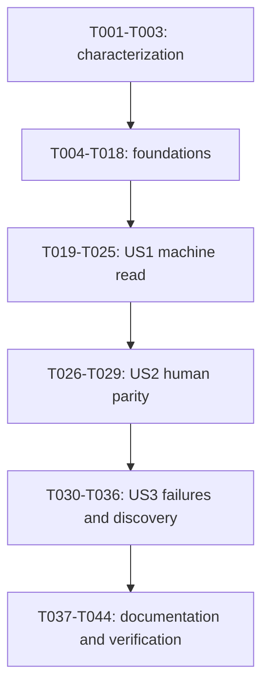

# Tasks: Order Info For Humans And Agents

**Input**: [spec.md](spec.md), [plan.md](plan.md), [research.md](research.md),
[data-model.md](data-model.md), [CLI contract](contracts/cli.md),
[validation guide](quickstart.md).

**Branch**: `develop` | **Generated**: 2026-10-28

**Status**: Not started: 0 of 44 tasks checked. This feature builds on the delivered
[order-list pilot](../001-order-list-json/tasks.md); that pilot's native Windows run is a separate
follow-up on a Windows machine and is not a prerequisite here. Checked tasks will represent only
their recorded scope.

**Tests**: Required by the specification and the constitution. For defects, reproduce the failing
behavior before a narrow repair and rerun that check immediately. Retain passing characterization
tests without fabricating failures. New-feature tests precede their implementation; when tests land
in an earlier task than their code, add compile-only `todo!("T0xx")` stubs and mark each test
`#[ignore = "red until T0xx"]`; show the ignored tests fail against the stubs and pass against a
throwaway prototype, and the implementing task removes its ignores and the prototype.

## Format And Paths

Each task has a checkbox, a sequential ID, optional `[P]`, a story label in story phases, exact
repository-relative paths and explicit dependencies. `[P]` means different-file work can overlap only
after the listed dependencies complete. There is no implicit authorization to spawn agents, commit,
push, change branches, touch a public node, or run regtest.

Paths are relative to mostro-cli. New source paths are planned homes, not assertions that files
exist. Reuse existing helpers and test files; create focused modules only where the plan requires
them. The constitution owns the coding rules.

All code increments run the focused checks first, then `cargo fmt --all -- --check`,
`cargo clippy --locked --all-targets --all-features -- -D warnings`, `cargo test --locked`, and
`cargo build --locked`, plus feature-specific gates. Check the declared minimum separately with
`cargo +1.94.0 check --locked --all-targets --all-features`. Record command, toolchain, platform,
fixture isolation, result and blockers in `tests/TEST_SUMMARY.md`. Never stage, commit, push, trade on
public nodes or read real identity secrets without authorization.

## Phase 1: Setup And Characterization

**Purpose**: Resume on `develop`, preserve the pilot, and pin down what exists before changing it.

- [ ] T001 Characterize the legacy `ordersinfo` command in `tests/cli_functions.rs` and `tests/TEST_SUMMARY.md`: its grammar (`-o/--orderids`, repeatable UUIDs), the message it builds (`Action::Orders`, `Payload::Ids`, identity key for signing and for the reply, `request_id`), that it creates the identity on first use and waits for the first message from the node, and its human output (`handle_orders_list_display` in `src/parser/dms.rs`). Record what is unverified. No production change. (depends on none)
- [ ] T002 [P] Confirm the baseline on `develop` (fmt, Clippy, tests, build, 1.94 check green) and record in `tests/TEST_SUMMARY.md` the production sizes of every file this feature touches (`src/cli.rs` 316, `src/cli/commands.rs` 316, `src/outcome.rs` 297, `src/outcome/schema.rs`, `src/msg/mod.rs`, `src/msg/receive_msg.rs`, `src/cli/schema.rs`) and that the four frozen legacy exceptions in `tests/integration_tests.rs` are unchanged. (depends on T001)
- [ ] T003 [P] Pin the wire facts the fixtures rely on in `tests/parser_orders.rs` (module `info_contract`): with the pinned `mostro-core` 0.17.3, a request `Payload::Ids` and the replies `Payload::Orders`, `Action::CantDo` with `not_found`, `too_many_requests` and `invalid_parameters` round-trip through `wrap_message_with` and `unwrap_incoming`, and `CantDoReason` serializes in snake case. A divergence stops the feature for a design correction. (depends on T001)

## Phase 2: Foundational Prerequisites

**Purpose**: The shared pieces every story needs. No story work before T018. Each piece is test-first.

- [ ] T004 [P] Extract the dispatch of migrated commands (listing, discovery) from `src/cli.rs` into `src/cli/migrated.rs`, behavior-preserving, with a top-level entry the third command can join; keep both files at most 400 production lines and rerun the whole order-list suite immediately. (depends on T002)
- [ ] T005 [P] Extract the process harness (`Sandbox`, `LoopbackRelay`, `Backend`, `Captured`, `run_with_watchdog`, `assert_no_effects`, `set_node_env` and their helpers) from `tests/order_list_process.rs` into `tests/common/harness.rs`, shared through `#[path]`; the existing 46 process tests pass unchanged and no assertion is weakened. (depends on T002)
- [ ] T006 Build the scripted fake daemon in `tests/common/fake_mostro.rs`: a client with generated node keys on the loopback relay that decrypts each request with `unwrap_incoming`, records it (signer, event kind and tags, `request_id`, ids), publishes a seeded kind-38385 info event (`protocol_version`, `pow`, `pow_first_contact`, `max_orders_per_response`) and replies by script (orders, subset, extras, duplicates, each `CantDo`, silence, delay, unrelated or wrong-id or wrong-author or malformed messages first). Add identity-store seeding that creates a real `mcli.db` with `sqlx` and a generated mnemonic. Self-test the fixture in `tests/order_info_process.rs`. (depends on T003, T005)
- [ ] T007 Add tests-first for the read-only identity loader in `src/identity.rs` (unit tests, compile-only `todo!("T008")` stub, ignored): absent directory, absent file, empty `users`, unreadable or non-SQLite file, valid store; assert nothing is created, no permission or content change (byte-identical file, no new sibling file), the error type separates `Missing` from `Unreadable`, and no mnemonic appears in any error text. (depends on T004)
- [ ] T008 Implement `src/identity.rs` and declare it in `src/lib.rs`: resolve `MCLI_DIR` or the home default without creating the directory, open `mcli.db` read-only with no-create options, read the `users` row, derive the identity key with one shared function, and make `User::get_identity_keys` in `src/db.rs` delegate to it so `db.rs` shrinks. Remove T007's ignores. (depends on T007)
- [ ] T009 Add tests-first in `src/outcome.rs` and `src/outcome/schema.rs` (ignored, red until T010): the eight new error codes and two warnings have fixed prose, the stated exits and wire names; request-stage constructors produce each stage combination of the [data model](data-model.md#errors); `error.reason` is omitted when absent and a snake-case string otherwise; and the generated `order.list` and `schema` documents stay equal to `docs/schemas` (the frozen pilot code and warning sets). (depends on T004)
- [ ] T010 Implement the outcome additions: codes, warnings and messages in `src/outcome.rs`, `ExecutionMeta` request constructors, the optional `reason`, `JsonSupport::Request` and its pre-execution stages in `src/cli/registry.rs`, and command-scoped `$defs` code and warning sets plus the `reason` property in `src/outcome/schema.rs` (`OutcomeRules` gains the extra codes, warnings and reason flag). `docs/schemas` fixtures must not change. Remove T009's ignores. (depends on T009)
- [ ] T011 Add tests-first for the typed data in `tests/parser_orders.rs` (module `info_contract`, ignored, red until T012) against compile-only stubs in `src/outcome/info.rs`: mapping from decoded replies in request order; unrequested and duplicate orders dropped; `not_returned`; the `not_found` success; canonical lowercase ids; trade pubkey normalization and the null fallback; RFC3339 and decimal time fields with the `invalid_order_timestamp` warning; signed 64-bit extremes as decimal strings; the buyer invoice never present; the every-id-exactly-once invariant. (depends on T003, T010)
- [ ] T012 Implement `src/outcome/info.rs` (`OrderInfoData`, `OrderRecord`, `OrderInfoInput`, the mapping and warnings) with schemars derives, reusing the pilot's decimal and time helpers. Remove T011's ignores. (depends on T011)
- [ ] T013 Add exchange contract tests in `tests/order_info_process.rs` (ignored, red until T017) against compile-only stubs of `ExchangeLimits`, `Outbound`, `Expect`, `Inbound` and `exchange` in `src/msg/exchange.rs`: exactly one request published, signed with the identity key and tagged to the node; the reply chosen by request id; unrelated, duplicate, own-echo, wrong-author, wrong-request and malformed messages ignored; deadline; the subscription armed before publishing; bounded cleanup after success, timeout and failure; no retry; injectable budgets through `ExchangeLimits`. (depends on T006, T010)
- [ ] T014 [P] Implement `src/msg/node_info.rs`: a bounded best-effort read of the node's kind-38385 info event and pure decisions for transport (explicit value wins; protocol 1 is unsupported; 2, other and absent mean `nip44`) and for advertised work against configured work, reusing the existing tag parser. Unit tests first for each decision and for a missing or malformed event. (depends on T010)
- [ ] T015 [P] Implement `src/msg/send_msg.rs` (private): wrap with `wrap_message_with` for the chosen transport and work, publish through the private client, and classify the result (accepted by at least one relay; every relay explicitly rejected; ambiguous). Unit tests first, using the loopback relay for accept and reject cases. (depends on T010)
- [ ] T016 [P] Implement `src/msg/reply.rs` (private): the correlated wait over the client's notifications using `select_reply_event`/`ExpectedReply`, decode with `unwrap_incoming`, a deadline, and distinct results for timeout, closed subscription and a decoded reply. Unit tests first for each. (depends on T010)
- [ ] T017 Implement `src/msg/exchange.rs` and export `exchange`, `ExchangeLimits`, `Outbound`, `Expect`, `Inbound` and `ExchangeFailure` (never the session or client): connect once, probe, apply the transport and work rules, arm, publish once, wait, post-timeout work probe, bounded cleanup; failures carry the code and the stage evidence. Remove T013's ignores and keep the privacy doctests passing. (depends on T013, T014, T015, T016)
- [ ] T018 Run the foundation checks: identity, outcome, DTO and exchange tests, the unchanged pilot suites and fixtures, then the required gates; record in `tests/TEST_SUMMARY.md` that the foundations passed without claiming any command exists. (depends on T008, T012, T017)

## Phase 3: US1 - Read My Own Order Record As Data (P1)

**Goal**: `order info --order UUID...` returns the node's record of the user's orders as one JSON
outcome, tied to its own request, with no local effects.

**Independent test**: Run the binary against the scripted daemon and a seeded identity store. Assert
the exact fields, one complete document, exactly one request event and no other event, a byte-identical
identity file, and that adversarial traffic around the reply never decides the result.

### US1 Tests First

- [ ] T019 [P] [US1] Extend `tests/cli_functions.rs` (ignored, red until T022): `order info` grammar (required, repeatable `--order`, any-case UUIDs canonicalised, repeated ids kept once in order, bad UUID is `invalid_arguments` with command `order.info`, no cap), the removed `ordersinfo` and `--orderids`, the registry mapping `order.info` to the path `order info` with `JsonSupport::Request` and its pre-execution stages, and that other legacy commands still reject JSON. (depends on T018)
- [ ] T020 [P] [US1] Extend `tests/order_info_process.rs` (ignored, red until T023) with the binary scenarios of the [validation guide](quickstart.md#acceptance-matrix) for success: one id; a subset; a repeated id; `not_found`; unrequested and duplicate orders in the reply; unrelated, other-request, own-echo, wrong-author and malformed messages first; `node_refused` with its reason; `reply_timeout` (shrunk budget); and, for every run, exactly one published event, an untouched sandbox, a byte-identical existing identity store, and the stage values of each outcome. (depends on T018)

### US1 Implementation

- [ ] T021 [US1] Implement `src/commands/order/info.rs` and declare it in `src/commands/order/mod.rs`: validate and deduplicate the ids, call `exchange` once, map `Orders`, `CantDo(not_found)`, other `CantDo` and unexpected replies to the typed outcome with the stages of the data model; no printing, exit, storage or client access. Operation-level tests pass against the fake daemon. (depends on T012, T017, T020)
- [ ] T022 [US1] Add `OrderCommands::Info` in `src/cli/commands.rs`, move the registry entry in `src/cli/registry.rs` to `["order","info"]` with `JsonSupport::Request`, and remove `Commands::OrdersInfo`, `src/cli/orders_info.rs`, its re-export in `src/cli.rs` and its arm in `src/cli/legacy.rs`; keep the core message-building tests in `tests/cli_functions.rs`. Remove T019's ignores. (depends on T019, T021)
- [ ] T023 [US1] Wire the dispatch in `src/cli/migrated.rs`: configuration with `--pow` and `--transport` (CLI over environment, no `set_var`), identity loading, the operation, then `parse_machine::emit` or the human path, with the early JSON guard unchanged for other commands and no prompt, stdin, logger from user input or `init_context`. Remove T020's ignores. (depends on T008, T020, T021, T022)
- [ ] T024 [US1] Add the remaining binary checks in `tests/order_info_process.rs`: many ids in one request without a CLI cap, verbose and closed stdin, an existing and an absent identity store, and the failing stdout and stderr writers (exit 1, one fixed line, no second document). (depends on T023)
- [ ] T025 [US1] Run the US1 focused matrix (`tests/cli_functions.rs`, `tests/parser_orders.rs`, `tests/order_info_process.rs`), then the required gates; record selected-field, correlation, single-request and no-effects evidence in `tests/TEST_SUMMARY.md` as an internal milestone, not feature acceptance. (depends on T024)

## Phase 4: US2 - Keep The Familiar Human Result (P2)

**Goal**: Human output keeps the readable order details under the new spelling, and both modes describe
the same orders.

**Independent test**: Render identical outcomes in both modes and compare ids, sides, statuses, amounts,
currency, payment methods, premium and times; run default and explicit human with redirected stdout.

- [ ] T026 [P] [US2] Extend `tests/parser_orders.rs` (module `info_contract`, ignored, red until T028) with pure-renderer parity: the familiar labelled lines, ranges, zero as market, missing optional values, the not-returned line and the empty case, UTC minute times or an invalid-date marker like JSON `null`, and escaped terminal control characters in node text. (depends on T025)
- [ ] T027 [P] [US2] Extend `tests/order_info_process.rs` for default and explicit human under redirected stdout, verbose and closed stdin, paired with JSON over identical scripted replies and a byte-identical identity store: identical selected business fields and zero changes in both modes, and the six `--output` positions returning the same document. (depends on T025)
- [ ] T028 [US2] Implement `src/parse_human/order_info.rs` (pure, typed data only, reusing `src/parse_human/table.rs` helpers) and select it in `src/cli/migrated.rs`; the failing writer paths keep the T024 behavior. Remove T026's ignores. (depends on T026, T027)
- [ ] T029 [US2] Run US2 parity, no-effects and default-mode acceptance through `tests/parser_orders.rs` and `tests/order_info_process.rs`, then the required gates; record in `tests/TEST_SUMMARY.md` without claiming discovery or the failure matrix. (depends on T028)

## Phase 5: US3 - Fail Safely And Be Discoverable (P2)

**Goal**: Offline discovery lists `order.info` truthfully, and every failure cause has its stable code,
exit status and stage evidence.

**Independent test**: Request `schema` with no node or identity; then drive each failure with controlled
inputs and verify the code, exit, what was published and that nothing is reported as an empty success.

### US3 Tests First

- [ ] T030 [P] [US3] Extend `src/outcome/schema.rs` and `src/cli/schema.rs` tests (ignored, red until T033): the generated `order.info` output schema has the success, failure and unresolved branches with the stage combinations of the data model, its own code and warning sets, the optional `reason` pattern, and a `$defs` that does not leak into `order.list` or `schema`; the input schema is the repeatable required `--order` UUID; real outcomes of every kind conform and mutations do not. (depends on T029)
- [ ] T031 [P] [US3] Extend `tests/order_info_process.rs` (ignored, red until T032) with the failure matrix: `identity_missing` and `identity_unreadable` (nothing created or changed), `configuration_missing` and `configuration_invalid` (including `--pow` and `--transport gift-wrap`), `protocol_unsupported`, `pow_required` before sending and after a timeout, `request_rejected` (all rejected versus ambiguous), `relay_connection_failed`, `relay_read_failed`, `reply_malformed`; planted secret sentinels in arguments, environment, relay URLs and node text never reach any stream; human mode prints one fixed line and an empty stdout. (depends on T029)

### US3 Implementation And Acceptance

- [ ] T032 [US3] Complete the failure mapping in `src/commands/order/info.rs` and `src/msg/exchange.rs`: every code and stage of the data model, preserved identity of the command, null data, no raw details, no `uncertain`, and the post-timeout work probe. Remove T031's ignores. (depends on T031, T017, T023)
- [ ] T033 [US3] Add `order.info` to `command_schemas` in `src/cli/schema.rs`, generate its output schema from the DTOs in `src/outcome/schema.rs` and its input schema from Clap, and make `required_configuration` list `MOSTRO_PUBKEY` and `RELAYS`. Remove T030's ignores. (depends on T030, T032)
- [ ] T034 [US3] Regenerate `docs/schemas/discovery-v1.json` and add `docs/schemas/order-info-v1.json` with the documented commands (never by a test or a workflow); add `specs/002-order-info-json/contracts/examples.json` as proposed fixtures; extend the `schema_fixtures` module in `tests/integration_tests.rs` so the drift checks cover the new file and the examples are validated against the owned constructors and the generated schema, with invalid type, null, enum and amount mutations. `docs/schemas/order-list-v1.json` must be unchanged. (depends on T033)
- [ ] T035 [US3] Run the full configuration, argument, exchange, unsupported-command and secret-sentinel matrix in `tests/order_info_process.rs` including failure after partial results and all output positions; prove one document where promised, safe empty-stdout fallbacks, exactly one request per run, and no retries or legacy execution. (depends on T034)
- [ ] T036 [US3] Run offline discovery, schema drift and stable-error acceptance in `tests/cli_functions.rs`, `tests/integration_tests.rs` and `tests/order_info_process.rs`, then the required gates; record coverage, version, field and error evidence in `tests/TEST_SUMMARY.md` and keep any failing scenario open. (depends on T035)

## Phase 6: Polish And Cross-Cutting Verification

**Purpose**: Publish current-code documentation and verify the whole feature. No `order new`, `order take`,
MCP change or release.

- [ ] T037 [P] Update `docs/architecture.md`: the new modules and boundaries (`identity`, `msg::exchange`, node info, `reply`), the recounted production inventory and the frozen exceptions, the first use of publication in `msg`, and that `ordersinfo` and its legacy handler are gone; link the constitution rather than copying it. (depends on T036)
- [ ] T038 [P] Update `docs/commands.md`, `README.md` and the [CLI contract](contracts/cli.md) status: `order info` replacing `ordersinfo`, repeatable `--order`, the not-returned and refusal semantics, the migration table, and the warning that the existing MCP's `get_order` stops working until it is migrated. (depends on T036)
- [ ] T039 Update the boundary and CI checks deliberately in `tests/integration_tests.rs` and `.github/workflows/ci.yml`: the frozen transport counts (`.send_event(` gains `msg/send_msg.rs`; `.subscribe(` and `.fetch_events(` gain their `msg` owners; no legacy count increases), `identity.rs` is the only new file allowed to open storage and must be read-only, and the wiring tests include the new fixture. Prove each rule by a mutation. (depends on T037, T038)
- [ ] T040 Run the Linux quickstart acceptance: every row of the [validation guide](quickstart.md) through `tests/order_info_process.rs` and the focused suites, with time, budget, cleanup, secret and no-effects evidence in `tests/TEST_SUMMARY.md`. (depends on T039)
- [ ] T041 Run final fmt, locked all-target all-feature Clippy with warnings denied, locked tests and build, and `cargo +1.94.0 check --locked --all-targets --all-features`; record exact results and any failure without upgrading the minimum. (depends on T040)
- [ ] T042 **Authorization required.** Run the regtest probe of the validation guide on the MCP repository's regtest network with the regtest identities only: one order created as Alice, then `order info` with that id, a foreign or random id, a mix, and more ids than the node's limit. Record the daemon version and each answer (`orders`, `not_found`, `too_many_requests`) and compare them with the fixtures' table; any difference reopens the affected tests. Skip and leave open if not authorized. (depends on T041)
- [ ] T043 Reconcile FR-001 through FR-011 and SC-001 through SC-006 with the actual evidence in `tests/README.md` and `tests/TEST_SUMMARY.md`, linking the contract and the generated fixtures. Windows and the regtest probe are listed as verified or open exactly as recorded; no scenario is relabeled complete by documentation alone. (depends on T041, T042)
- [ ] T044 Update the feature status in `specs/002-order-info-json/plan.md`, `spec.md`, `checklists/requirements.md`, `AGENTS.md` and `../plan-aiReadyMostroCli.md` only to the extent proven by T043, retain the remaining blockers (native Windows, regtest, the unmigrated commands and MCP), and stop without staging, committing, publishing or starting `order new`. (depends on T043)

## Dependencies And Execution Order

Task dependencies are authoritative; no story starts before the foundation gate (T018). US2 and US3 reuse
US1's operation, dispatch and harness, so their integration is sequential; each still has independent
observable acceptance criteria. The renderer lands in US2 after the machine path, and the failure matrix and
schemas in US3 after both modes work.

## Parallel Examples

Only these groups are marked `[P]`. Wait for the common dependency, then join before the next dependent task.
They edit disjoint files.

| Work | Common prerequisite | Parallel tasks | Join |
| --- | --- | --- | --- |
| Setup | T001 | T002 baseline and sizes; T003 wire facts | T004, T005 |
| Foundations | T002 | T004 `cli/migrated.rs`; T005 shared harness | T006, T007 |
| Exchange doors | T010 | T014 node info; T015 send; T016 reply | T017 |
| US1 tests | T018 | T019 grammar and registry; T020 binary scenarios | T021, T022 |
| US2 tests | T025 | T026 renderer parity; T027 process parity | T028 |
| US3 tests | T029 | T030 schemas; T031 failure matrix | T032, T033 |
| Documentation | T036 | T037 architecture; T038 commands and README | T039 |

Do not run independent Cargo jobs against shared mutable build or evidence state merely because test authoring is
parallelizable. Tasks editing the same harness or production module stay serialized.

## Requirements And Acceptance Ownership

| Requirement | Primary tasks |
| --- | --- |
| FR-001 / FR-001a: ids, no cap, not-returned, `not_found` | T011, T012, T019-T022, T024 |
| FR-002: read-only, one request, identity key | T006-T008, T013, T017, T020, T023, T024 |
| FR-003: correlated reply, deadline, cleanup | T013, T016, T017, T020 |
| FR-004: versioned outcome and data | T009-T012, T021, T030 |
| FR-005: published evidence, no `uncertain` | T009, T010, T020, T031, T032 |
| FR-006: parity, default human, no prompt | T026-T029 |
| FR-007: stable failures | T009, T010, T031, T032, T035, T036 |
| FR-008: discovery, fixtures, unmigrated guard | T030, T033, T034, T036 |
| FR-009: shared transport boundary | T014-T017, T039 |
| FR-010: untrusted text and diagnostics | T026, T031, T035 |
| FR-011: documented contract | T037, T038, T043 |
| SC-001 / SC-001a: one document, many ids | T020, T024, T035 |
| SC-002: correlation under noise | T013, T020 |
| SC-003: one request, no state change | T008, T020, T024, T027 |
| SC-004: parity and id accounting | T011, T026, T027 |
| SC-005: discovery and failure codes | T030-T036 |
| SC-006: Linux and Windows, no secrets | T031, T035, T040, T041 (Windows is a follow-up on a native machine) |

## Implementation Strategy

1. Characterize and prove the wire facts, then build the foundations test-first: shared harness, fake daemon, read-only identity, outcome additions, typed data and the private exchange. Stop at a failed prerequisite rather than bypass it.
2. Deliver US1 as the first internal milestone (T025): the machine read with correlation and no effects.
3. Add the human renderer (US2), then the failure matrix, schemas and fixtures (US3); run each story's gate and the required checks as it lands.
4. Finish documentation, boundary and CI checks, the Linux acceptance run and the final gates; the regtest probe (T042) needs separate authorization, and native Windows is a follow-up on a native machine.

**MVP**: T001-T025 is the first internal demonstration. A complete feature needs all three stories and T037-T044;
no default-human, discovery, safety or platform requirement is waived, and the daemon behavior stays unverified
until T042.

**Task counts**: 44 total: setup 3, foundations 15, US1 7, US2 4, US3 7, cross-cutting 8. Fifteen tasks are marked `[P]`
in seven groups. None is checked.
